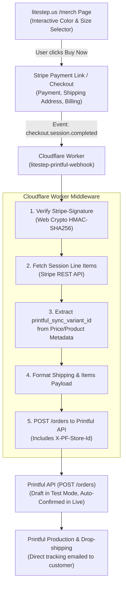

# Stripe + Cloudflare Worker + Printful Integration Walkthrough
**Platform:** [litestep.us](https://litestep.us)  
**Objective:** Automated, zero-subscription print-on-demand fulfillment bridge connecting static Jekyll pages, Stripe Checkout, and Printful fulfillment via an edge Cloudflare Worker.

---

## 1. System Overview & Architecture



---

## 2. Credentials & Environment Reference

| Service | Setting / Credential | Format / Example | Where Found |
| :--- | :--- | :--- | :--- |
| **Printful** | API Access Token | `personal_token_...` | Printful Dashboard > Settings > API > Stores/Access Tokens |
| **Printful** | Store ID | `18881050` | Printful Dashboard > Stores (or via `GET /stores`) |
| **Stripe** | Test Secret Key | `sk_test_51...` | Stripe Dashboard (Test Mode) > Developers > API keys |
| **Stripe** | Live Secret Key | `sk_live_51...` | Stripe Dashboard (Live Mode) > Developers > API keys |
| **Stripe** | Webhook Signing Secret | `whsec_...` | Stripe Dashboard > Developers > Webhooks (after endpoint creation) |
| **Cloudflare** | Wrangler CLI | Node CLI (`wrangler`) | Installed via `npm install -g wrangler` or `npx wrangler` |

---

## 3. Product Setup & Automated Stripe Catalog Sync

Rather than manually entering dozens of size and color combinations into the Stripe Dashboard, products are designed in Printful and synced automatically to Stripe via a Python script.

### 3.1. Design in Printful
1. Navigate to **Printful Dashboard > Stores** and open your **API Store** (e.g., Store ID `18881050`).
2. Click **Add Product** (e.g., Bella + Canvas 3001 Unisex T-Shirt).
3. Upload front/back print graphics, select available colors, and save.
4. Note the generated **Sync Product ID** from the URL or API (e.g., `480089207`).

### 3.2. Automated Sync Script (`sync_to_stripe.py`)
Run the synchronization script located at `litestep-site/sync_to_stripe.py`.

```python
import os
import requests
import stripe
from decimal import Decimal

STRIPE_SECRET_KEY = "sk_test_YOUR_KEY"   # Switch to sk_live_... for production
PRINTFUL_API_KEY = "YOUR_PRINTFUL_TOKEN"
PRINTFUL_STORE_ID = "18881050"
PRINTFUL_PRODUCT_ID = "480089207"

stripe.api_key = STRIPE_SECRET_KEY

# 1. Fetch variants from Printful
res = requests.get(
    f"https://api.printful.com/store/products/{PRINTFUL_PRODUCT_ID}",
    headers={
        "Authorization": f"Bearer {PRINTFUL_API_KEY}",
        "X-PF-Store-Id": PRINTFUL_STORE_ID
    }
)
res.raise_for_status()
data = res.json()["result"]
product_name = data["sync_product"]["name"]
variants = data["sync_variants"]

# 2. Group by color (Product = Color, Price = Size)
colors = {}
for v in variants:
    colors.setdefault(v["color"], []).append(v)

for color, color_variants in colors.items():
    image_url = color_variants[0]["files"][1]["preview_url"] if len(color_variants[0].get("files", [])) > 1 else None
    images = [image_url] if image_url else []

    stripe_product = stripe.Product.create(
        name=f"{product_name} - {color}",
        description=f"Bella + Canvas 3001 Unisex Tee in {color}.",
        images=images,
        metadata={
            "printful_sync_product_id": str(PRINTFUL_PRODUCT_ID),
            "color": color
        }
    )

    for v in color_variants:
        size = v["size"]
        sync_variant_id = str(v["id"])
        raw_price = v.get("retail_price", "0.00")
        price_cents = int(Decimal(raw_price) * 100)

        stripe.Price.create(
            product=stripe_product.id,
            unit_amount=price_cents,
            currency="usd",
            nickname=f"Size {size}",
            metadata={
                "printful_sync_variant_id": sync_variant_id,
                "size": size,
                "color": color
            }
        )
```

---

## 4. Front-End Integration (`litestep-site/merch/index.md`)

To let buyers choose their preferred color and size without cluttering the page with 70+ static buttons, embed an interactive card with a dynamic selector.

```html
<!-- Mount Whitney Ridgelines Direct Merch Card -->
<div class="card" style="padding: 0; overflow: hidden;" id="whitney-merch-card">
  <div style="display: flex; align-items: center; justify-content: center; height: 260px; background: #ffffff;">
    
  </div>
  <div style="padding: 1.25rem;">
    <div style="font-size: 0.75rem; text-transform: uppercase; font-weight: 700; color: var(--text-muted); margin-bottom: 0.35rem;">
      Sierra Peaks · Direct Print-on-Demand
    </div>
    <h3 style="margin: 0 0 0.75rem 0; font-size: 1.15rem; line-height: 1.35;">
      Mount Whitney Ridgelines Unisex T-Shirt
    </h3>
    <p style="font-size: 0.9rem; color: var(--text-muted); margin-bottom: 1rem;">
      Stacked vector ridgelines of Mount Whitney (14,505 ft) printed on Bella + Canvas 3001 premium jersey cotton.
    </p>

    <!-- Selectors -->
    <div style="display: flex; gap: 0.5rem; margin-bottom: 1rem;">
      <select id="whitney-color-select" style="flex: 1; padding: 0.5rem; border-radius: 4px; border: 1px solid var(--border);">
        <option value="Black" selected>Color: Black</option>
        <option value="Navy">Color: Navy</option>
        <option value="Dark Grey">Color: Dark Grey</option>
        <option value="Cardinal">Color: Cardinal</option>
        <option value="Natural">Color: Natural</option>
      </select>
      <select id="whitney-size-select" style="flex: 1; padding: 0.5rem; border-radius: 4px; border: 1px solid var(--border);">
        <option value="S">Size: S ($26.87)</option>
        <option value="M" selected>Size: M ($26.87)</option>
        <option value="L">Size: L ($26.87)</option>
        <option value="XL">Size: XL ($26.87)</option>
        <option value="2XL">Size: 2XL ($28.87)</option>
      </select>
    </div>

    <!-- Buy Button -->
    <a
      id="whitney-buy-btn"
      href="https://buy.stripe.com/test_DEFAULT_LINK"
      target="_blank"
      rel="noopener"
      class="btn btn-primary"
      style="width: 100%; text-align: center; display: block; box-sizing: border-box;"
    >
      Buy Now →
    </a>
  </div>
</div>
```

---

## 5. Cloudflare Worker Webhook Middleware

### 5.1. Wrangler Configuration (`wrangler.toml`)
```toml
name = "litestep-printful-webhook"
main = "src/index.js"
compatibility_date = "2026-01-01"

[vars]
PRINTFUL_CONFIRM_ORDERS = "false" # Set to "true" after end-to-end testing verification
```

### 5.2. Worker Implementation (`src/index.js`)
```javascript
/**
 * Cloudflare Worker: Stripe to Printful Order Bridge
 */
export default {
  async fetch(request, env) {
    if (request.method !== "POST") {
      return new Response("Method Not Allowed", { status: 405 });
    }

    const signatureHeader = request.headers.get("Stripe-Signature");
    if (!signatureHeader) {
      return new Response("Missing Stripe-Signature header", { status: 400 });
    }

    const rawBody = await request.text();

    // 1. Verify Stripe HMAC-SHA256 signature
    const isValid = await verifyStripeSignature(
      rawBody,
      signatureHeader,
      env.STRIPE_WEBHOOK_SECRET,
      300 // 5-minute replay tolerance
    );

    if (!isValid) {
      return new Response("Invalid signature", { status: 401 });
    }

    let event;
    try {
      event = JSON.parse(rawBody);
    } catch (err) {
      return new Response("Malformed JSON", { status: 400 });
    }

    // 2. Handle completed checkout sessions
    if (event.type === "checkout.session.completed") {
      const session = event.data.object;
      try {
        await handleCheckoutCompleted(session, env);
      } catch (err) {
        console.error("Fulfillment processing error:", err);
        // Returning 500 signals Stripe to retry transient upstream failures
        return new Response(`Processing error: ${err.message}`, { status: 500 });
      }
    }

    return new Response(JSON.stringify({ received: true }), {
      status: 200,
      headers: { "Content-Type": "application/json" }
    });
  }
};

/**
 * Verifies Stripe signature via native Web Crypto API
 */
async function verifyStripeSignature(payload, signatureHeader, secret, toleranceSeconds) {
  try {
    const parts = signatureHeader.split(",").reduce((acc, part) => {
      const [key, val] = part.trim().split("=");
      if (key === "t") acc.timestamp = val;
      if (key === "v1") acc.signatures.push(val);
      return acc;
    }, { timestamp: null, signatures: [] });

    if (!parts.timestamp || parts.signatures.length === 0) return false;

    const currentTime = Math.floor(Date.now() / 1000);
    if (Math.abs(currentTime - parseInt(parts.timestamp, 10)) > toleranceSeconds) {
      return false;
    }

    const encoder = new TextEncoder();
    const signedPayload = `${parts.timestamp}.${payload}`;
    const key = await crypto.subtle.importKey(
      "raw",
      encoder.encode(secret),
      { name: "HMAC", hash: "SHA-256" },
      false,
      ["sign"]
    );

    const expectedBuffer = await crypto.subtle.sign(
      "HMAC",
      key,
      encoder.encode(signedPayload)
    );

    const expectedHex = Array.from(new Uint8Array(expectedBuffer))
      .map(b => b.toString(16).padStart(2, "0"))
      .join("");

    return parts.signatures.some(sig => sig === expectedHex);
  } catch (err) {
    console.error("Signature verification error:", err);
    return false;
  }
}

/**
 * Retrieves line items from Stripe and creates an order in Printful
 */
async function handleCheckoutCompleted(session, env) {
  // Support both new Stripe API (collected_information.shipping_details) and legacy (shipping_details)
  const shipping =
    session.collected_information?.shipping_details ||
    session.shipping_details ||
    {};
  const customer = session.customer_details || {};
  const address = shipping.address || customer.address || {};

  if (!address.line1 || !address.city) {
    throw new Error("No valid shipping address (line1/city) found on checkout session.");
  }

  // Retrieve expanded line items
  const stripeResponse = await fetch(
    `https://api.stripe.com/v1/checkout/sessions/${session.id}/line_items?expand[]=data.price.product`,
    {
      headers: {
        Authorization: `Bearer ${env.STRIPE_SECRET_KEY}`
      }
    }
  );

  if (!stripeResponse.ok) {
    throw new Error(`Failed to retrieve line items: ${await stripeResponse.text()}`);
  }

  const lineItemsData = await stripeResponse.json();
  const printfulItems = [];

  for (const item of lineItemsData.data) {
    const product = item.price.product;
    const syncVariantId =
      item.price.metadata?.printful_sync_variant_id ||
      product.metadata?.printful_sync_variant_id;

    if (!syncVariantId) {
      throw new Error(`Item "${item.description}" lacks "printful_sync_variant_id" metadata.`);
    }

    printfulItems.push({
      sync_variant_id: parseInt(syncVariantId, 10),
      quantity: item.quantity
    });
  }

  const externalId = session.payment_intent || session.id.slice(-32);

  const printfulOrderPayload = {
    confirm: env.PRINTFUL_CONFIRM_ORDERS === "true",
    recipient: {
      name: shippingDetails.name,
      address1: shippingDetails.address.line1,
      address2: shippingDetails.address.line2 || "",
      city: shippingDetails.address.city,
      state_code: shippingDetails.address.state,
      country_code: shippingDetails.address.country,
      zip: shippingDetails.address.postal_code,
      email: session.customer_details?.email
    },
    items: printfulItems,
    external_id: externalId
  };

  const headers = {
    "Content-Type": "application/json",
    Authorization: `Bearer ${env.PRINTFUL_API_KEY}`
  };
  if (env.PRINTFUL_STORE_ID) {
    headers["X-PF-Store-Id"] = env.PRINTFUL_STORE_ID;
  }

  const printfulRes = await fetch("https://api.printful.com/orders", {
    method: "POST",
    headers: headers,
    body: JSON.stringify(printfulOrderPayload)
  });

  const printfulData = await printfulRes.json();
  if (!printfulRes.ok) {
    if (
      printfulData.error?.api_error_code === "OR-13" ||
      String(printfulData.result).includes("already exists")
    ) {
      console.log(`Order with external_id ${externalId} already exists in Printful. Handled idempotently.`);
      return printfulData;
    }
    throw new Error(`Printful API rejected order: ${JSON.stringify(printfulData)}`);
  }

  return printfulData;
}
```

---

## 6. End-to-End Testing & Verification Runbook

### Step 1: Deploy Worker in Test Mode
```bash
# Set secrets inside the worker directory
wrangler secret put STRIPE_WEBHOOK_SECRET  # Webhook signing secret (whsec_...) from Stripe Test Mode
wrangler secret put STRIPE_SECRET_KEY      # sk_test_...
wrangler secret put PRINTFUL_API_KEY       # Printful Personal Access Token
wrangler secret put PRINTFUL_STORE_ID      # e.g., 18881050

# Deploy
wrangler deploy
```
Copy the deployed worker URL: `https://litestep-printful-webhook.<subdomain>.workers.dev`.

### Step 2: Register Stripe Webhook
1. In Stripe Dashboard (Test Mode toggled ON), navigate to **Developers > Webhooks**.
2. Click **Add endpoint**.
3. Endpoint URL: `https://litestep-printful-webhook.<subdomain>.workers.dev`.
4. Listen for events: `checkout.session.completed`.
5. Reveal the **Signing secret** (`whsec_...`) and update via `wrangler secret put STRIPE_WEBHOOK_SECRET` if not already matching.

### Step 3: Run Simulated Checkout
1. Open your test Payment Link.
2. Fill out name, shipping address, and test credit card (`4242 4242 4242 4242`).
3. Complete checkout.

### Step 4: Verify Order Bridge
1. **Cloudflare:** Run `wrangler tail` or inspect Cloudflare dashboard logs; verify HTTP `200 OK`.
2. **Printful:** Open [Printful Dashboard > Orders](https://www.printful.com/dashboard/default/orders).
   * Confirm the new order appears in **Draft** status.
   * Verify the correct garment, color, size, and shipping address are populated.

### Step 5: Cut Over to Live Production
1. **Stripe:** Toggle Test Mode to **Live Mode**.
2. **Re-run Sync Script:** Set `STRIPE_SECRET_KEY = "sk_live_..."` in `sync_to_stripe.py` and run it once to create all live catalog items and links.
3. **Register Live Webhook:** In Stripe Live Mode, create the webhook endpoint pointing to your worker and record the live `whsec_...`.
4. **Update Worker for Production:**
   ```bash
   wrangler secret put STRIPE_SECRET_KEY      # sk_live_...
   wrangler secret put STRIPE_WEBHOOK_SECRET  # live whsec_...
   ```
   In `wrangler.toml`, change:
   ```toml
   PRINTFUL_CONFIRM_ORDERS = "true"
   ```
   Re-deploy:
   ```bash
   wrangler deploy
   ```
5. **Update Site:** Swap test payment links with live payment links in `litestep-site/merch/index.md` and commit to Git.

---

## 7. Ongoing Maintenance & Operations

### Adding a New Design
1. Create the product template in your Printful API Store.
2. Update `PRINTFUL_PRODUCT_ID` in `sync_to_stripe.py` and run `python sync_to_stripe.py`.
3. Add the new card snippet to `merch/index.md`.
4. *No changes needed to Cloudflare Worker.*

### Adjusting Prices
* Prices in Stripe are fixed once created. To alter prices:
  * Either adjust them directly in the Stripe Dashboard under **Product catalog**, or
  * Update markup logic in `sync_to_stripe.py` and regenerate.

### Stock & Variant Changes
* If a color or size goes out of stock in Printful, simply remove that option from the `<select>` element in `merch/index.md`.
