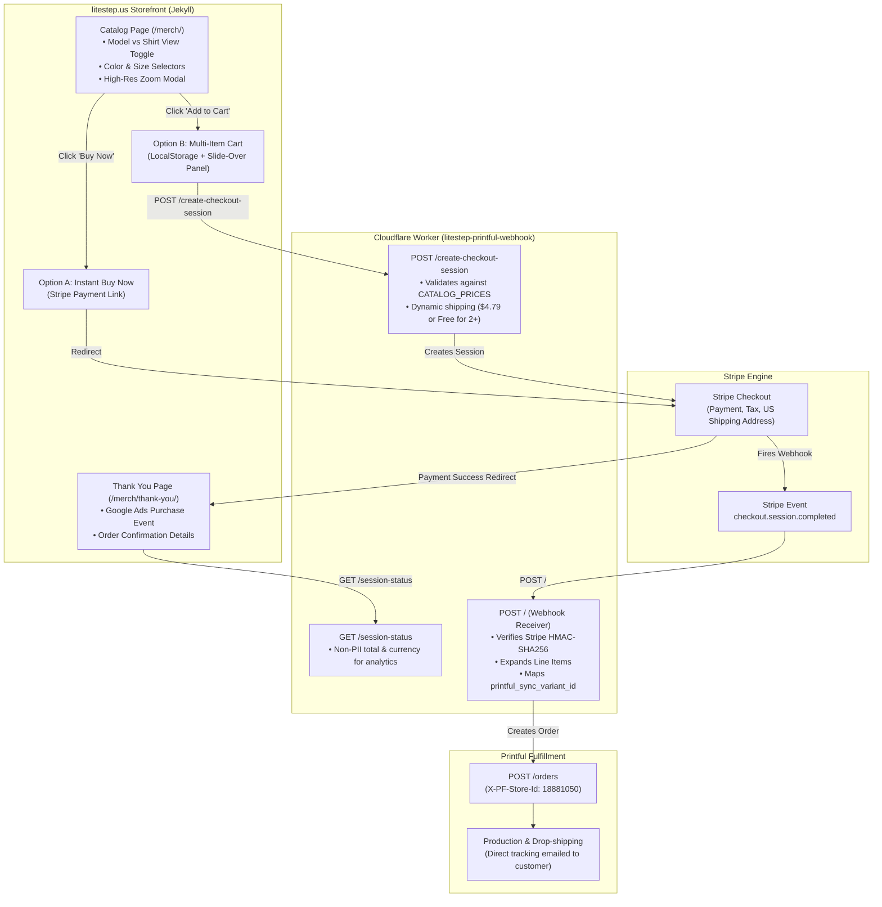

# Stripe + Cloudflare Worker + Printful Integration Walkthrough
**Platform:** [litestep.us](https://litestep.us)  
**Objective:** Fully automated, zero-subscription print-on-demand fulfillment bridge connecting static Jekyll pages, Stripe Checkout, and Printful fulfillment via an edge Cloudflare Worker.

---

## 1. System Overview & Architecture

The architecture provides two checkout experiences while maintaining a zero-maintenance, serverless infrastructure:
1. **1-Click Buy Now**: Direct Stripe Payment Links for single-item purchases.
2. **Multi-Item Shopping Cart**: Client-side slide-over cart with dynamic shipping tiers (e.g. Free US shipping on 2+ items) powered by Cloudflare Worker checkout sessions.



---

## 2. Credentials & Environment Reference

| Service | Setting / Credential | Format / Example | Where Found / Managed |
| :--- | :--- | :--- | :--- |
| **Printful** | API Personal Access Token | `0eSXIvdhy...` | Printful Dashboard > Settings > API > Personal Access Tokens |
| **Printful** | Store ID | `18881050` | Printful Dashboard > Stores (or via `GET /stores`) |
| **Stripe** | Test Secret Key | `sk_test_51...` | Stripe Dashboard (Test Mode) > Developers > API keys |
| **Stripe** | Live Secret Key | `sk_live_51...` | Stripe Dashboard (Live Mode) > Developers > API keys |
| **Stripe** | Webhook Signing Secret | `whsec_...` | Stripe Dashboard > Developers > Webhooks |
| **Cloudflare** | Wrangler CLI | Node CLI (`wrangler`) | Run in `litestep-printful-webhook/` |
| **Worker URL** | Production Endpoint | `https://litestep-printful-webhook.jbcohn.workers.dev` | Cloudflare Dashboard / Wrangler Deploy |

---

## 3. Automated Catalog Synchronization (`sync_to_stripe.py`)

The synchronization script ([sync_to_stripe.py](file:///Users/joshcohn/Developer/litestep-site/sync_to_stripe.py)) serves as the central automation engine. It synchronizes the entire Printful catalog directly with Stripe, automatically generates 2000px high-resolution mockups, and outputs the structured data needed by both Jekyll and Cloudflare.

### 3.1. Key Responsibilities
1. **Printful Product Extraction**: Fetches all sync products and variants from the Printful API store (`GET /store/products`).
2. **Stripe Product & Price Idempotency**:
   - Creates or updates Stripe Products and Prices matching each color and size.
   - Tags every Price with `metadata.printful_sync_variant_id` so the webhook worker can immediately fulfill orders.
   - Generates active Stripe Payment Links with US shipping address collection and redirect to `/merch/thank-you/?session_id={CHECKOUT_SESSION_ID}`.
   - Automatically archives obsolete or unlinked Stripe products.
3. **Dual-View Mockup Generator API Automation**:
   - Queues asynchronous generation tasks (`POST /mockup-generator/create-task/{cat_prod_id}`) to produce 2000px flat garment mockups and lifestyle model mockups.
   - Automatically adapts placements: `front_large` for Bella 3001/3413 tees, `front` for muscle tanks, `default` for bodycon dresses, and `front` + `back` for one-piece swimsuits.
   - Composites alpha channels onto pure white (`#ffffff`) backgrounds to eliminate dark rendering artifacts while preserving lifestyle model photos.
4. **Garment Size Guide & Measurement Illustration Sync**:
   - Queries Printful size specifications (`GET /products/{id}/sizes`) for all catalog garments in both inches and centimeters.
   - Downloads diagram measurement illustrations locally to `assets/images/size_guides/`.
   - Cleans HTML instructions and formats measurements with standard fractions (`½`, `¼`, etc.) and decimal conversions.
   - Writes `litestep-site/_data/size_guides.json`.
5. **Data Contract Exports**:
   - Writes `litestep-site/_data/merch_products.json` (the single source of truth for the Jekyll site).
   - Writes `litestep-printful-webhook/src/catalog_prices.js` (server-side price table used by the worker to prevent client-side cart tampering).

### 3.2. Product Metadata Configuration (`PRODUCT_METADATA`)
Custom marketing copy, category tags, model mockup styles, and print placement configurations are declared centrally in `sync_to_stripe.py`:

```python
PRODUCT_METADATA = {
    481791025: {  # California Shaded Elevations
        "display_name": "California Shaded Elevations Topographic Graphic T-Shirt",
        "tag": "California Topography · Direct Print-on-Demand",
        "description": "High-definition shaded relief elevation profile of California from coast to summit. Printed on ultra-soft tri-blend tees.",
        "model_prefix": "model_california",
        "primary_color": "Charcoal-Black Triblend",
        "model_config": {
            "option_group": "Women's Lifestyle",
            "option": "Front",
            "top": 200,
            "placements": ["front_large"]
        },
        "flat_config": {
            "option_group": "Flat",
            "option": "Front",
            "placements": ["front_large"]
        }
    },
    483500528: {  # One-Piece Swimsuit
        "display_name": "Violet Eye Hexagon Mandala One-Piece Swimsuit",
        "tag": "Fractal Art · Direct Print-on-Demand",
        "description": "Vivid all-over print featuring an intricate violet and cyan hexagon fractal mandala. Smooth, chlorine-resistant fabric with UPF 50+ protection.",
        "model_prefix": "model_one_piece_swimsuit",
        "primary_color": "White",
        "model_config": {
            "option_group": "Women's 2",
            "option": "Front",
            "placements": ["front", "back"]
        }
    }
}
```

### 3.3. Running the Sync
```bash
cd /Users/joshcohn/Developer/litestep-site
# Ensure STRIPE_SECRET_KEY and PRINTFUL_API_KEY are in .env or exported
python3 sync_to_stripe.py
```

---

## 4. Front-End Storefront Architecture (`merch/index.md`)

The merch catalog at [merch/index.md](file:///Users/joshcohn/Developer/litestep-site/merch/index.md) is completely data-driven by Jekyll reading `site.data.merch_products`.

### 4.1. Dual-View Mockup Toggle
Every product card provides an interactive toggle between flat product photography and on-model lifestyle mockups:
- Context-sensitive label: displays **"Shirt View"** for tees, tanks, and hoodies, and **"Product View"** for dresses and swimsuits.
- State-preserving color matching: selecting a new colorway updates both the flat and model image sources simultaneously.

### 4.2. Interactive Garment Size Guides
Every product card features a dedicated **"Size Guide"** trigger button with a ruler icon positioned immediately above the size dropdown selector:
- **Product-Specific Sizing**: Clicking the trigger opens the guide pre-selected to that exact garment (e.g. Bella + Canvas 3001 T-Shirt, 3413 Triblend, Hooded Long Sleeve, Muscle Tank, Bodycon Dress, or Swimsuit).
- **Dual Measurement Tabs**: Shoppers can toggle between **"Product measurements"** (measuring a flat garment at home) and **"Measure yourself"** (measuring body circumferences).
- **Unit Toggle**: Instant switcher between **Inches** (with clean fractions like `16 ½″`) and **Centimeters** (with 1-decimal conversions).
- **Visual Diagram & Step-by-Step Instructions**: Displays local measurement illustrations showing exactly where A Length, B Width / Chest, C Waist, and D Hips are measured.
- **Garment Switcher**: Allows buyers to explore size charts across all catalog garments without leaving the modal.

### 4.3. Multi-Item Shopping Cart
- **Slide-Over Drawer**: Buyers can click **"Add to Cart"** to add items with selected color and size options.
- **LocalStorage Persistence**: Cart contents persist across page refreshes (`litestep_merch_cart_v1`).
- **Promotional Shipping Tier**:
  - 1 item: Standard US Shipping ($4.79).
  - 2+ items: **FREE US Shipping** automatically unlocked with a visual progress bar.
- **Checkout Launch**: The **"Proceed to Checkout"** button transmits cart line items to the Cloudflare Worker (`/create-checkout-session`), which verifies the pricing against `CATALOG_PRICES` and redirects the user to Stripe Checkout.

### 4.4. Instant 1-Click "Buy Now"
Directly below the cart button, a secondary **"Buy Now"** button links straight to the single-item Stripe Payment Link for the chosen color and size, bypassing the cart for quick impulse purchases.

### 4.5. Analytics & Google Ads Conversion Tracking
- **Header Pixel**: Google Tag (`gtag.js` with ID `AW-18518076612`) is embedded in `_layouts/default.html`.
- **E-commerce Events**:
  - `add_to_cart`: Fires whenever an item is added to the slide-over cart.
  - `begin_checkout`: Fires when the buyer clicks checkout or a direct Payment Link.
  - `purchase`: Fires on [/merch/thank-you/](file:///Users/joshcohn/Developer/litestep-site/merch/thank-you.md). The thank-you page retrieves order total and currency from the worker (`/session-status?session_id=...`) and deduplicates conversion reporting via `sessionStorage`.

---

## 5. Cloudflare Worker Edge Middleware (`litestep-printful-webhook`)

Located in [`/Users/joshcohn/Developer/litestep-printful-webhook`](file:///Users/joshcohn/Developer/litestep-printful-webhook), this serverless worker runs at the Cloudflare edge with zero persistent infrastructure costs.

### 5.1. Route Overview
1. `POST /create-checkout-session`
   - Accepts cart items `{ items: [{ sync_variant_id, quantity }] }`.
   - Validates each variant against `CATALOG_PRICES` to prevent client-side price modification.
   - Enforces the free shipping rule (0 cents for $\ge 2$ items, 479 cents for 1 item).
   - Generates a Stripe Checkout Session with tax calculation and US address collection.
2. `GET /session-status?session_id=cs_...`
   - Safely queries Stripe API for order total, currency, and payment status.
   - Returns non-PII financial summary to the `/merch/thank-you/` page for conversion tracking.
3. `POST /` (Stripe Webhook Receiver)
   - Verifies Stripe HMAC-SHA256 signature using the Web Crypto API (`crypto.subtle`).
   - Listens for `checkout.session.completed`.
   - Normalizes customer shipping details from both current (`collected_information.shipping_details`) and legacy Stripe payload formats.
   - Expands line items to extract `printful_sync_variant_id`.
   - Dispatches order to Printful API (`POST /orders`).
   - Idempotently ignores duplicate orders (`external_id = session.id` or `payment_intent`).

### 5.2. Worker Deployment & Secrets
```bash
cd /Users/joshcohn/Developer/litestep-printful-webhook

# Configure secrets in Cloudflare
wrangler secret put STRIPE_SECRET_KEY
wrangler secret put STRIPE_WEBHOOK_SECRET
wrangler secret put PRINTFUL_API_KEY
wrangler secret put PRINTFUL_STORE_ID

# Deploy
wrangler deploy
```

---

## 6. Operational Runbooks

### 6.1. Adding a New Product to the Store
1. **Design in Printful**:
   - Go to Printful Dashboard > Stores > API Store (`18881050`).
   - Create the product template, upload graphics, select colors/sizes, and save.
   - Note the **Sync Product ID** (e.g. `483500528`).
2. **Add Metadata Entry**:
   - Open `sync_to_stripe.py` and add an entry under `PRODUCT_METADATA`:
     ```python
     483500528: {
         "display_name": "New Product Display Title",
         "tag": "Collection Tag · Direct Print-on-Demand",
         "description": "Engaging product description.",
         "model_prefix": "model_new_product",
         "primary_color": "Black",
         "model_config": {
             "option_group": "Men's Lifestyle",
             "option": "Front",
             "placements": ["front_large"]
         },
         "flat_config": {
             "option_group": "Flat",
             "option": "Front",
             "placements": ["front_large"]
         }
     }
     ```
3. **Execute Sync**:
   ```bash
   cd /Users/joshcohn/Developer/litestep-site
   python3 sync_to_stripe.py
   ```
   *The script will generate mockups, update Stripe, write `_data/merch_products.json`, and update `litestep-printful-webhook/src/catalog_prices.js`.*
4. **Deploy Updated Worker**:
   ```bash
   cd /Users/joshcohn/Developer/litestep-printful-webhook
   wrangler deploy
   ```
5. **Commit and Push Frontend**:
   ```bash
   cd /Users/joshcohn/Developer/litestep-site
   git add _data/merch_products.json assets/images/products/ sync_to_stripe.py
   git commit -m "Add new product to catalog"
   git push origin main
   ```

### 6.2. Adjusting Prices or Margins
- Prices in Stripe are immutable once created.
- To update prices:
  1. Modify variant retail prices in Printful or update the pricing calculation in `sync_to_stripe.py`.
  2. Re-run `python3 sync_to_stripe.py` (creates new Stripe Prices, updates Payment Links, and updates `catalog_prices.js`).
  3. Re-deploy the Cloudflare Worker (`wrangler deploy`).

### 6.3. Toggling Between Test Mode and Live Production
- **Test Mode**:
  - `STRIPE_SECRET_KEY = "sk_test_..."` in `.env` and `wrangler secret put STRIPE_SECRET_KEY`.
  - In `wrangler.toml`: `PRINTFUL_CONFIRM_ORDERS = "false"` (orders created as Drafts in Printful).
- **Live Production**:
  - `STRIPE_SECRET_KEY = "sk_live_..."`.
  - In `wrangler.toml`: `PRINTFUL_CONFIRM_ORDERS = "true"` (orders automatically confirmed and sent to production).
  - Register Stripe Webhook in Stripe Live Dashboard pointing to `https://litestep-printful-webhook.jbcohn.workers.dev`.
